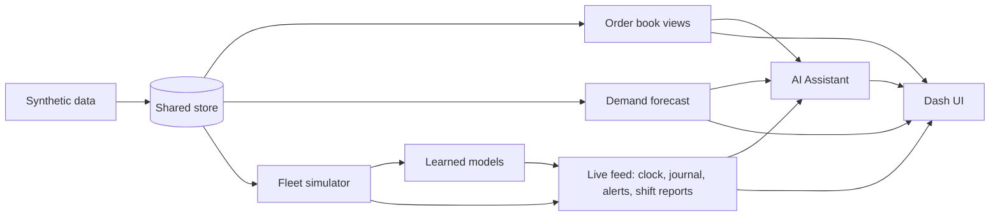

<p align="center">
  
</p>

<h1 align="center">FulfilmentIQ</h1>

<p align="center">
  An order-to-delivery control centre for a cement company: the order book, release planning,
  a live truck fleet, machine learning predictions and an AI assistant, in one Dash app.
</p>

<p align="center">
  
  
  
  
  
</p>

> **All data is synthetic.** Martina Cement Plc is a fictional company. Every customer, order,
> truck and person is generated, so the whole project runs out of the box with no credentials.


## What it does

Cement is sold on contracts, released to a loading queue in parts, and lifted by trucks that
can wait a day at a customer's site. Planners juggle all three at once. This dashboard puts
them on one screen and tells each team what to act on next.

| Page | Sub-tabs | What it answers |
| --- | --- | --- |
| **Executive Summary** | | Ordered, lifted, fill rate, backlog and value; where attention is needed today |
| **Analytics** | Backlog Health, Dispatch, Order Ageing, Action List, Data Explorer | Where the backlog sits, how fast it moves, which customers need a call |
| **Operations** | Release Planning, Partial Releases, FIFO Watch, Order Book, Shipping Points, Demand Forecast | What to release next, what is stuck, who was served out of turn, what demand is coming |
| **Logistics** | Tracking, Control Tower, Live Map, Plants & Depots, Readiness, Rerouting, Pre-Dispatch Risk, Transporters, Shift Reports, Predictions, Model Health | Where every truck is, which sites are not ready, where to reroute, how good the models are |
| **AI Assistant** | | Plain-English questions across every page, answered only from the dashboard's figures |

### Highlights

- **A live control tower.** 140 trucks run on a simulated clock: loading, driving, waiting
  inside each customer's receiving hours, getting rerouted, losing GPS. One background thread
  serves every viewer.
- **Machine learning that has to earn its place.** Four gradient-boosted models (delay risk,
  time on site, arrival, back at base) are tested on trips they never saw and take over from a
  plain rule only when they beat it. Every prediction is scored later on Model Health.
- **A seven-day demand forecast** trained on 18 months of orders, with a 1-in-10 to 9-in-10
  range and a per-region fallback to the rule where the rule is more accurate.
- **Readiness and rerouting.** Six checks per customer (credit hold, funds, free bays,
  receiving hours, the area rep's call, learned risk) and a ranked list of ready sites near any
  truck that has waited too long.
- **Alerts with routing.** Triggers become emails for the right desk, rep and depot
  supervisor; without SMTP settings they wait in an outbox you can inspect.
- **An assistant that cannot invent numbers.** Facts are gathered from the same views the
  pages use; answers containing numbers that are not in the facts are rewritten. Works with a
  Groq key, and in a built-in demo mode without one.
- **Fast by design.** Version-keyed caching, a timeline-based simulator (60 days of fleet
  history in about three seconds) and per-tab refresh so only what is on screen updates.

## Screenshots

| | |
| --- | --- |
|  |  |
| **Tracking**: every truck, its delivery and predicted times | **Control Tower**: time on site and an owned exception queue |
|  |  |
| **Live Map**: trucks by stage, customers by readiness | **Rerouting**: ready customers near a truck past the trigger |
|  |  |
| **Readiness**: should this site receive a truck now, and why | **Predictions**: model against rule, what each model leans on |
|  |  |
| **Release Planning**: what to release for the chosen horizon | **Demand Forecast**: next 7 days with a range |
|  |  |
| **Action List**: customers to call and poor lifters | **AI Assistant**: a briefing across every page |

## Run it

You need Python 3.10 or newer.

```bash
git clone https://github.com/<your-username>/fulfilmentiq.git
cd fulfilmentiq
python -m venv .venv
# Windows: .venv\Scripts\activate      macOS and Linux: source .venv/bin/activate
pip install -r requirements.txt
python run.py
```

Open http://127.0.0.1:8050. The order book is ready at once; the Logistics page needs about
ten seconds the first time while it builds 60 days of fleet history and trains its models.

**PyCharm:** open the folder, set the interpreter to the new `.venv`, right-click `run.py`
and choose *Run*. To run the tests, right-click the `tests` folder and choose *Run pytest*.

### Optional settings

Copy `.env.example` to `.env`. Everything is optional:

- `GROQ_API_KEY`: a free key from console.groq.com turns on written answers in the assistant.
- `SMTP_*`: send alert emails instead of keeping them in the outbox.
- `MC_MAP_STYLE=outline`: draw state borders only (for offline use).
- Business rules such as the reroute trigger or cover thresholds: see
  [docs/business-rules.md](docs/business-rules.md).

### Bring your own data

```bash
python scripts/generate_data.py data/sample     # writes every table as CSV
```

Edit the files or replace them with your own in the same columns
([docs/data-dictionary.md](docs/data-dictionary.md)), then set `MC_DATA_SOURCE=csv` and
`MC_DATA_DIR=data/sample` in `.env`.

### Deploy

```bash
docker build -t fulfilmentiq . && docker run -p 8050:8050 fulfilmentiq
```

or on any Procfile host (Render, Railway, Heroku). Keep **one worker**: the data and the
fleet live in memory and are shared by every viewer.

## How it is built



- **Stack:** Dash, Dash Mantine Components, AG Grid, Plotly, pandas, scikit-learn, Groq API.
- **Data:** an 18-month generator with seasonality, customer behaviour and a three-level
  order lifecycle (contract, release, lift).
- **Simulation:** each trip is a timeline of timestamps planned in time order, so queues,
  overnight waits and long stays emerge from the rules rather than random draws.
- **Testing:** 27 pytest tests, including a clean-room check that the repository names no real
  company. CI runs them on every push.

More detail in [docs/architecture.md](docs/architecture.md).

```
martina/
  data/        schema, synthetic generator, shared store
  orderbook/   pipeline, analytics, operations, demand forecast
  logistics/   clock, world, simulator, learning, rules, reports, live feed
  ai/          Groq client and the assistant
  alerts/      alert routing and email
  ui/          app shell, theme, components, charts, maps, pages
tests/         pytest suite
docs/          architecture, business rules, data dictionary, company profile
```

## About

Built by Samuel Chukwuma, a data scientist working on supply chain and order fulfilment,
as a portfolio project. Martina Cement Plc and everything in its data are invented
([company profile](docs/company-profile.md)); the problems it solves are real ones from
the cement industry.

Released under the MIT licence.