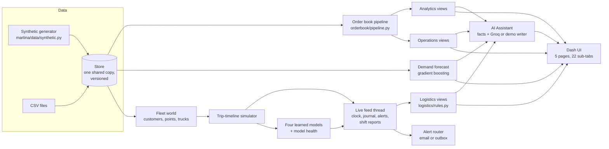

# Architecture



## Design choices

**One shared copy of the data.** `STORE` holds the tables and the derived order
book in memory. Every refresh bumps a version number; every view is cached on
(version, filters, options), so nothing is recomputed between refreshes and
nothing stale survives one. This is why the app runs with a single worker and
several threads.

**Views are plain functions.** `orderbook/analytics.py`, `orderbook/operations.py`
and `logistics/rules.py` return DataFrames and dicts. The pages, the Excel
export and the AI Assistant all call the same functions, so a figure on screen,
in the workbook and in an answer can never disagree.

**The fleet is a timeline, not a tick loop.** Each trip is planned in one go as
a set of timestamps (assigned, gate out, arrival, offload, back at base).
A truck's stage and position at any moment are read off that timeline, which is
why 60 days of history for 140 trucks build in about three seconds. Trucks are
planned in time order through a heap, so each trip knows the queues at its
loading point and its customer's site.

**Time that counts.** Site time is measured only inside each customer's
receiving window, trucks drive only between 05:00 and 22:00, and dispatchers
hold loads that would arrive after a site closes. Those three rules are what
make long stays, overnight waits and reroutes emerge naturally.

**Models must earn their place.** Each learned model (delay risk, time on site,
arrival, back at base) is tested on the newest quarter of trips it never saw
and takes over from its plain rule only if it is more accurate there. Every
prediction made at dispatch is scored later; Model Health shows model against
rule, day by day.

**One live clock for everyone.** A single background thread moves the control
tower clock. Pages only read a snapshot rebuilt once per tick, so ten viewers
cost the same as one. Each sub-tab carries its own refresh interval, so only
the tab on screen updates.

**The assistant cannot make numbers up.** Facts are gathered from the same views,
fenced and labelled as data. With a Groq key the model writes from those facts;
answers with numbers that are not in the facts are sent back for a rewrite.
Without a key a demo writer builds the answer from the same facts. Requests to
change the rules or reveal configuration are refused before any model sees them.

## Folder map

```
martina/
  brand.py            company, products, works, depots, transporters, colours
  config.py           settings and business rules (all overridable in .env)
  geo.py              states, regions, towns, distances
  cache.py            version-keyed result cache
  export.py           the Excel management workbook
  data/               schema, synthetic generator, shared store
  orderbook/          pipeline, analytics, operations, demand forecast
  logistics/          clock, world, simulator, learning, rules, reports, live feed
  ai/                 Groq client and the assistant
  alerts/             alert routing and email
  ui/                 Dash app shell, theme, components, charts, maps, pages
tests/                pytest suite (data, views, models, simulator, assistant, app, clean-room check)
```
